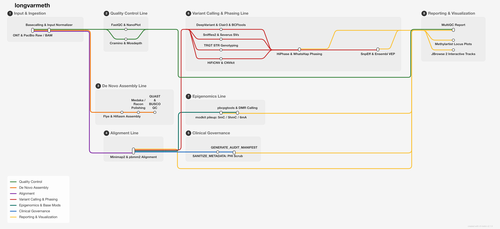

# longvarmeth

[](https://github.com/JD2112/quindecagon)
[](https://github.com/JD2112/longvarmeth/actions/workflows/quindecagon-audit.yml)
[](https://nf-co.re)
[](https://github.com/anchore/syft)
[](https://github.com/gitleaks/gitleaks)
[](https://github.com/psf/black)
[](https://flake8.pycqa.org)
[](https://github.com/JD2112/longvarmeth/actions/workflows/ci.yml)

A modular Nextflow DSL2 evaluation and research platform with forensic clinical governance controls for single-molecule long-read genomics and epigenomics (**Oxford Nanopore & PacBio HiFi**). It features an explicit 12-stage analytical architecture with host GPU-accelerated basecalling/demux, pre- and post-alignment QC, *de novo* assembly & polishing, native kinetic tag streaming (`MM`/`ML`), modular small variant calling (`DeepVariant`, `Clair3`, `BCFtools`), structural variant calling (`Sniffles2`, `TRGT`, `CNVkit`), joint multi-variant haplotype co-phasing (`HiPhase`, `WhatsHap`), automated truth-set benchmarking (`hap.py`, `Truvari`), full-chain PHI de-identification and SHA-256 provenance manifests (inspired by `milou`), and a transparent MultiQC execution status matrix.

> [!IMPORTANT]
> **Intended Use & Regulatory Statement**:  
> LongVarMeth is designed for **Research Use Only (RUO)** and clinical evaluation. It is not an FDA-cleared or CE-IVD diagnostic device. While the architecture enforces strict clinical governance mechanisms (PHI scrub, deterministic anonymization, cryptographic audit trail), clinical laboratories must establish analytical validity independently in compliance with local regulatory standards (CAP/CLIA, ISO 15189) before reporting clinical findings. See [docs/validation.md](docs/validation.md).

## Pipeline Architecture




### Platform-Specific Workflow Execution Matrix

| Stage | Oxford Nanopore <br> (`--platform ont`) | PacBio HiFi <br> (`--platform pacbio`) | Inputs $\rightarrow$ Outputs |
| :--- | :--- | :--- | :--- |
| **1. Input Checksum** | Ingestion SHA-256 verification | Ingestion SHA-256 verification | Raw files $\rightarrow$ Audit manifest |
| **2. Basecalling & Demux**<br>*(ONT raw)* | Host GPU `Dorado`<br>+ `pod5 convert` demux | *On-instrument demux*<br>(Revio / Sequel IIe) | `pod5` / `fast5` $\rightarrow$ Basecalled BAM |
| **3. Read QC & Trimming** | `FastQC` + `NanoPlot`<br>`Cramino` + `Filtlong` | `Cramino` + `FastQC`<br>`NanoPlot` | Reads / BAM $\rightarrow$ Yield & Q-scores |
| **4. Alignment & Tag Streaming** | `minimap2 -ax map-ont -y`<br>*(streaming MM/ML tag preservation)* | `pbmm2 align --preset HIFI`<br>*(native kinetic preservation)* | Reads + Ref $\rightarrow$ Sorted BAM (`MM`/`ML`) |
| **5. Mod Tag Verification** | `CHECK_MOD_TAGS`<br>*(samtools view aux check)* | `CHECK_MOD_TAGS`<br>*(kinetics validation)* | Sorted BAM $\rightarrow$ Kinetic Tag Audit Log |
| **6. Small Variants** | `DeepVariant` (`ONT_R104`)<br>`Clair3` / `BCFtools` | `DeepVariant` (`PACBIO`)<br>`Clair3` / `BCFtools` | Sorted BAM $\rightarrow$ SNV / InDel VCF |
| **7. SVs, CNVs & STRs** | `Sniffles2` (SVs)<br>`CNVkit` (CNVs) | `Sniffles2` (SVs) + `HiFiCNV`<br>`TRGT` (tandem repeats) | Sorted BAM $\rightarrow$ SV, CNV & STR calls |
| **8. Epigenomics** | `modkit pileup`<br>(5mC / 5hmC / 6mA motifs) | `pbcpgtools` (`aligned_bam_to_cpg_scores`)<br>+ `methbat` | Sorted BAM $\rightarrow$ BedMethyl & CpG scores |
| **9. Joint Co-Phasing** | `WhatsHap phase`<br>+ `haplotag` (`HP:i:1/2`) | `HiPhase`<br>*(joint SNV + SV + STR co-phasing)* | VCFs + BAM $\rightarrow$ Phased VCF & Haplotagged BAM |
| **10. Truth-Set Benchmark** | `hap.py` (SNVs/Indels)<br>+ `Truvari` (SVs) | `hap.py` (SNVs/Indels)<br>+ `Truvari` (SVs) | VCFs + GIAB HG002 $\rightarrow$ Precision/Recall/F1 TSVs |
| **11. Clinical Governance** | `SANITIZE_BAM` + `SANITIZE_VCF`<br>+ cryptographic SHA-256 manifest | `SANITIZE_BAM` + `SANITIZE_VCF`<br>+ cryptographic SHA-256 manifest | Artifacts $\rightarrow$ Sanitized BAM/VCF & manifest.json |
| **12. Visualization & Reporting**| `JBrowse 2` + `Methylartist`<br>`MultiQC` Execution Status Matrix | `JBrowse 2` + `Methylation Dashboard`<br>`MultiQC` Execution Status Matrix | BAMs, VCFs $\rightarrow$ MultiQC Report & Tracks |

### Multi-Organism Tailoring Matrix

| Organism Profile | Target Scope | Ploidy | Specialized Calling & Assembly Behavior |
| :--- | :--- | :---: | :--- |
| **Human**<br>(`-profile human`) | Clinical diagnostics, rare disease,<br>germline/somatic WGS | Diploid<br>(`2`) | • Full variant matrix (`DeepVariant` + `Sniffles2` + `TRGT` + `HiPhase`)<br>• Whole-genome 5mCG methylation & imprinting DMRs<br>• Clinical VEP/ClinVar consequence annotation & PHI scrubbing |
| **Eukaryote**<br>(`-profile eukaryote`) | Non-model plants, animals,<br>fungi, invertebrates | Diploid<br>(`2`) | • Reference-guided or *de novo* assembly with `Hifiasm` / `Flye`<br>• Lineage-specific gene completeness benchmark via `BUSCO`<br>• Reference-free phased methylomics |
| **Prokaryote**<br>(`-profile prokaryote`) | Bacteria, archaea, plasmids,<br>microbial isolates | Haploid<br>(`1`) | • Single-contig circularized assembly via `Flye` / `Hifiasm`<br>• Circularity verification & replication origin analysis<br>• Restriction-modification (R-M) motif detection (4mC, 6mA, 5mC) |
| **Virus**<br>(`-profile virus`) | Viral genomics, amplicons,<br>quasispecies, phages | Haploid<br>(`1`) | • Amplicon-aware quality & length filtering<br>• Low-frequency intra-host diversity variant detection (relaxed 5% threshold)<br>• Metagenomic assembly mode (`--meta`) |

## Quickstart

### 1. Oxford Nanopore Reference-Based Run
```bash
nextflow run main.nf \
  -profile human,singularity \
  --platform ont \
  --input samplesheet.csv \
  --ref_nuc /path/to/GRCh38.fa \
  --outdir results_ont
```

### 2. PacBio HiFi Reference-Based Run
```bash
nextflow run main.nf \
  -profile human,singularity \
  --platform pacbio \
  --input samplesheet_pacbio.csv \
  --ref_nuc /path/to/GRCh38.fa \
  --enable_trgt \
  --repeat_bed /path/to/pathogenic_repeats.bed \
  --outdir results_pacbio
```

### 3. Bacterial Assembly & Methylation
```bash
nextflow run main.nf \
  -profile prokaryote,singularity \
  --input samplesheet.csv \
  --run_type de_novo_assembly \
  --outdir results_bacteria
```

### 4. Viral Genome Analysis
```bash
nextflow run main.nf \
  -profile virus,singularity \
  --input samplesheet_viral.csv \
  --ref_nuc /path/to/viral_ref.fasta \
  --outdir results_viral
```


## Key Parameters

You can configure execution parameters from the command line or via custom config files:

| Parameter | Type | Default | Description |
| :--- | :--- | :--- | :--- |
| `--input` | string | `samplesheet.csv` | Path to CSV samplesheet (`run_id,input_path,input_type,...`). Supports `pod5`, `fast5`, `ubam`, `pacbio_bam`, or pre-aligned `aligned_bam`. |
| `--outdir` | string | `results` | Output directory destination |
| `--platform` | string | `ont` | Long-read sequencing technology (`ont`, `pacbio`) |
| `--species` | string | `eukaryote` | Target biology profile (`human`, `eukaryote`, `prokaryote`, `virus`) |
| `--run_type` | string | `reference_based` | Analysis workflow mode (`reference_based`, `de_novo_assembly`) |
| `--ref_nuc` | string | `""` | Path to nuclear reference genome FASTA |
| `--snv_caller` | string | `bcftools` | Small variant caller (`bcftools`, `deepvariant`, `clair3`) |
| `--sv_caller` | string | `sniffles` | Structural variant caller (`sniffles`, `severus`, `pbsv`) |
| `--phasing_tool` | string | `whatshap` | Haplotype phasing engine (`whatshap`, `hiphase`) |
| `--cnv_caller` | string | `cnvkit` | Copy number variant caller (`cnvkit`, `hificnv`) |
| `--skip_variants` | boolean | `false` | Skip all variant calling (SNVs, SVs, CNVs, STRs) to run a pure methylation pipeline |
| `--skip_methylation` | boolean | `false` | Skip all epigenomics (Modkit / pb-cpg-tools) to run a pure variant pipeline |
| `--skip_alignment` | boolean | `false` (auto for `aligned_bam`) | Bypass Minimap2/pbmm2 alignment when providing pre-aligned coordinate-sorted BAMs |
| `--enable_trgt` | boolean | `false` | Enable tandem repeat genotyping via TRGT |
| `--repeat_bed` | string | `""` | Path to TRGT repeat definition BED catalog |
| `--enable_phi_sanitization`| boolean | `true` | Privacy-by-default: strip personal health information (PHI) & hospital run barcodes from BAM/VCF headers |
| `--enable_audit_trail` | boolean | `true` | Generate cryptographic SHA-256 manifests and forensic provenance records |
| `--enable_vep` | boolean | `false` | Enable Ensembl VEP functional variant annotation |
| `--enable_snpeff` | boolean | `false` | Enable SnpEff variant annotation |
| `--enable_methylation_dashboard` | boolean | `false` (auto in `human`) | Generate interactive AG-Grid & IGV-Web clinical methylation report (adapted from `gms-nallo`) |
| `--run_benchmarking` | boolean | `false` | Enable empirical truth-set concordance evaluation (`hap.py` + `Truvari`) |
| `--benchmark_truth_vcf` | string | `""` | Path to NIST GIAB HG002 small variant truth VCF |
| `--benchmark_truth_bed` | string | `""` | Path to NIST GIAB HG002 small variant benchmark region BED |
| `--benchmark_sv_truth_vcf` | string | `""` | Path to NIST GIAB HG002 structural variant truth VCF |
| `--benchmark_sv_truth_bed` | string | `""` | Path to NIST GIAB HG002 structural variant benchmark region BED |
| `--dorado_bin` | string | `dorado` | Host path to Dorado binary for host GPU-accelerated basecalling |

---

## Biological Scope & Technology Limitations

Understanding the physical and algorithmic boundaries of single-molecule sequencing is critical for valid result interpretation:

1. **Oxford Nanopore R10.4.1 Chemistry**:
   - **Simplex vs Duplex**: Simplex R10.4.1 reads achieve modal Q20+ raw accuracy. However, small insertion/deletion (indel) errors persist in homopolymer tracts ($N \ge 6$) due to ionic current dwell-time saturation. Indel findings in homopolymers should be interpreted conservatively.
   - **Base Modifications**: Oxford Nanopore chemistry natively distinguishes 5mC, 5hmC, and unmethylated cytosines using `modkit pileup`. High-confidence quantification requires $\ge 15\times$ read depth per CpG site.
2. **PacBio HiFi Chemistry (Revio / Sequel IIe)**:
   - **Consensus Accuracy**: HiFi circular consensus sequencing achieves Q30+ base quality, yielding exceptional SNV and indel accuracy ($F_1 > 0.99$).
   - **Kinetics**: 5mC detection relies on inter-pulse duration (IPD) kinetics aggregated via `pbcpgtools` (`aligned_bam_to_cpg_scores`). BAM inputs must preserve kinetics tags (`MM`, `ML` or pulse tags).
3. **Joint Haplotype Co-Phasing (`HiPhase` / `WhatsHap`)**:
   - **Phase Block Continuity**: Long-range phase blocks depend on read length N50 and sample heterozygosity. In extended runs of homozygosity (ROH) or low-complexity segmental duplications, phase blocks break deterministically.
   - **Multi-Variant Resolution**: HiPhase jointly co-phases small variants, SVs (`Sniffles2`), and STR repeat expansions (`TRGT`) into unified phase sets (`PS`).

---

## Truth-Set Benchmarking & MultiQC Execution Matrix

LongVarMeth introduces automated truth-set benchmarking using the NIST / GIAB HG002 reference standard:

```bash
# Run automated GIAB benchmark check in stub mode:
nextflow run main.nf -profile test_giab -stub
```

The resulting `multiqc_report.html` features:
- **Pipeline Execution Status Matrix**: Explicit table classifying each of the 12 pipeline stages as `COMPLETED`, `SKIPPED (Pre-aligned Input)`, `SKIPPED (Parameter-Disabled)`, or `FAILED`, ensuring incomplete runs are never mistaken for completed analyses.
- **Hap.py Concordance Table**: Precision, recall, and F1 scores stratified by variant class.
- **Truvari SV Benchmark Table**: TP, FP, FN, recall, and F1 scores for structural variants $\ge 50$ bp.
- **Cryptographic Audit Manifest**: Full-chain SHA-256 provenance tracking.

For full validation procedures and benchmark calibrations, see **[docs/validation.md](docs/validation.md)**.


## Species Profiles

Preconfigured profiles load ploidy, reference genomes, and calling parameters:

| Profile | Target Organism Type | Key Settings |
| :--- | :--- | :--- |
| `-profile human` | *Homo sapiens* | Diploid (`--ploidy 2`), hg38 defaults, WhatsHap/HiPhase phasing, VEP/SnpEff enabled |
| `-profile eukaryote` | Non-Model Eukaryotes | Diploid ploidy, reference-guided or Hifiasm/Flye assembly with BUSCO lineage QC |
| `-profile prokaryote`| Bacteria & Archaea | Haploid (`--ploidy 1`), circularized assembly, bacterial 4mC/6mA/5mC motif detection |
| `-profile virus` | Viruses (Amplicons / Quasispecies) | Haploid (`--ploidy 1`), relaxed 5% frequency cutoffs for intra-host diversity |


## Testing

Run test suites using official, lightweight public `nf-core/test-datasets`:

```bash
# Nanopore test run:
nextflow run main.nf -profile test_ont,singularity

# PacBio HiFi test run:
nextflow run main.nf -profile test_pacbio,singularity

# Dry-run syntax & topology check:
nextflow run main.nf -profile test_pacbio -stub
```


## Output Structure

Detailed outputs are published in `--outdir` (default: `results/`):

```
results/
├── qc/                       # FastQC, Cramino, NanoPlot, Mosdepth reports
├── assembly/                 # Flye / Hifiasm assemblies, Medaka polished contigs, QUAST & BUSCO
├── alignments/               # Coordinate-sorted BAMs, MM/ML tagged BAMs, haplotagged BAMs
├── variants/                 # SNV VCFs, Sniffles2 SVs, TRGT STRs, HiFiCNV / CNVkit CNVs
├── methylation/              # Modkit 5mC/5hmC pileup BED files, pbcpgtools scores, DMR tables
├── audit/                    # Cryptographic SHA-256 manifests and forensic provenance records
├── jbrowse/                  # Interactive JBrowse 2 web workspace directory
└── multiqc/                  # Consolidated multi-sample MultiQC report
```
See [docs/output.md](docs/output.md) for full descriptions.

## Reproducibility & Version Lock

To ensure exact forensic reproducibility across clinical production runs, the pipeline includes a **`version_lock`** profile. When activated, it forces Nextflow to use exact container SHA digests listed in `conf/version_lock.config` and documented in `versions.yml`.

```bash
nextflow run main.nf -profile human,singularity,version_lock [parameters]
```

## Citations

If you use `longvarmeth` in your research, please cite the pipeline:

> Das, J. (2026). *longvarmeth: A Unified Nextflow DSL2 Platform for Clinical Long-Read Genomics and Epigenomics (Nanopore & PacBio HiFi)*. GitHub: [https://github.com/JD2112/longvarmeth](https://github.com/JD2112/longvarmeth).

Please also cite the underlying bioinformatics tools listed in [CITATIONS.md](CITATIONS.md).


## License & Acknowledgements

* **License**: This project is licensed under the [MIT License](LICENSE).
* **Acknowledgements**:
  * Built using community best practices from [nf-core](https://nf-co.re).
  * Clinical governance and audit trail architecture adapted from [`milou`](https://github.com/JD2112/milou).
  * Interactive clinical methylation dashboard adapted from [`gms-nallo-methylation-dashboard`](https://github.com/JD2112/gms-nallo-methylation-dashboard).
  * Metro-map architecture rendered with [nf-metro](https://github.com/seqeralabs/nf-metro).
